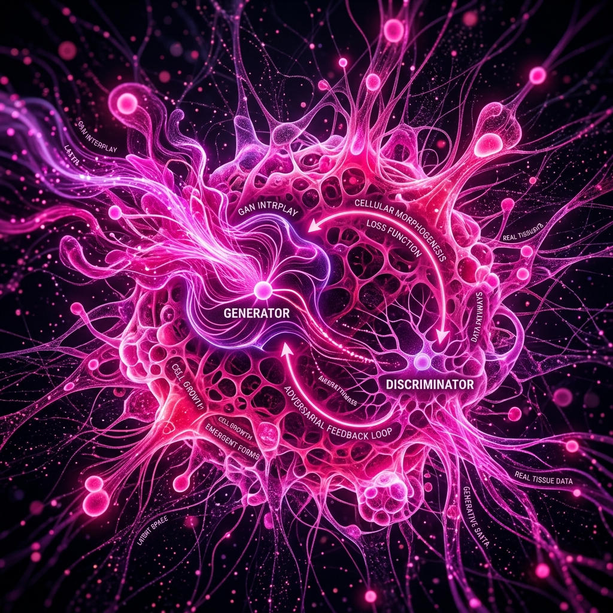

# Strategic Imaging AI Portfolio

**REF.ID: SP-DS-2026**  
Live Deployment: [https://www.stephthedev.de](https://www.stephthedev.de)

Professional portfolio of **Stephan Pfeiffer**, bridging 20 years of digital imaging and signal processing (TV Editor & Colorist) with applied data science and computer vision architectures (MSc student at HSLU).



## Overview

The site showcases technical case studies spanning digital pathology, remote sensing, and industrial defect inspection. It is engineered with a blueprint aesthetic: mono-spaced typography, technical grids, and dark/light mode toggles.

### Key Technical Aspects

- **Framework**: [Astro v5/v7](https://astro.build/) with static HTML generation (`output: "static"`).
- **Styling**: [Tailwind CSS v4](https://tailwindcss.com/) using native CSS `@theme` tokens in `src/styles/global.css`.
- **Content Collections**: Type-safe schema validation via Zod in `src/content.config.ts`.
- **Accessibility**: Keyboard-navigable tabs (`role="tablist"` / `role="tab"` / `role="tabpanel"`), accessible accordions, explicit ARIA attributes, skip-to-content link, and `prefers-reduced-motion` compliance.
- **Theme**: Dark and light mode with early `<head>` script execution to eliminate flashes of unstyled theme.
- **SEO & Semantics**: Open Graph, Twitter Cards, JSON-LD `Person` schema, `@astrojs/sitemap`, and `robots.txt`.

## Getting Started

### Prerequisites

- Node.js `>=22.12.0` (see [.nvmrc](.nvmrc))
- npm

### Installation & Development

```bash
# Clone the repository
git clone https://github.com/Steph-The-Dev/strategic-imaging-ai-portfolio.git

# Install pinned dependencies
npm ci

# Start development server at http://localhost:4321
npm run dev
```

### Build & Type Check

```bash
# Validate TypeScript and Astro components
npx astro check

# Build production static bundle in ./dist/
npm run build

# Preview production build locally
npm run preview
```

## Project Structure

```text
/
├── .github/
│   └── workflows/
│       └── build.yml           # CI workflow (lint, astro check, build)
├── docs/                       # Project documentation & design guides
│   ├── DESIGN.md
│   ├── GEMINI.md
│   └── REFACTORING_GUIDE.md
├── public/                     # Static assets served at root
│   ├── images/                 # Patch images for interactive comparisons
│   ├── favicon.*
│   ├── operator_profile.jpg    # Social sharing image
│   ├── robots.txt              # Search engine directives
│   ├── sitemap-index.xml       # Generated sitemap
│   └── stain_visualization.png
├── src/
│   ├── assets/                 # Optimized images processed by Astro
│   ├── components/             # Reusable UI components
│   │   ├── CareerPhase.astro   # Timeline module card
│   │   ├── CaseStudies.astro   # Interactive project console (tabs + accordion)
│   │   ├── Contact.astro       # Contact terminal with no-JS fallback
│   │   ├── Expertise.astro     # Experience and career phase grid
│   │   ├── Footer.astro        # Footer with metadata and links
│   │   ├── Header.astro        # Sticky navigation and theme toggle
│   │   ├── Hero.astro          # Hero section with headline and status
│   │   ├── Profile.astro       # Profile section with interactive portrait
│   │   └── StainComparison.astro # Before/after image slider
│   ├── content/
│   │   └── projects/           # Markdown project case studies
│   │       ├── solar-esg-pipeline.md
│   │       ├── stain-normalization.md
│   │       └── surface-defect-detection.md
│   ├── layouts/
│   │   └── Layout.astro        # Global HTML shell, SEO, JSON-LD, dark mode
│   ├── pages/
│   │   └── index.astro         # Main one-page portfolio layout
│   ├── styles/
│   │   └── global.css          # Tailwind v4 configuration and utilities
│   └── content.config.ts       # Content collections schema
├── .nvmrc                      # Node.js version pinning
├── astro.config.mjs            # Astro configuration with sitemap integration
├── package.json
└── tsconfig.json
```

## Editing Content

Projects are managed as an Astro content collection in `src/content/projects/*.md`.

To add a new project:
1. Create a markdown file, e.g. `src/content/projects/my-new-project.md`.
2. Provide the required frontmatter specified by `src/content.config.ts`:

```yaml
---
title: "Project Title"
description: "A concise, factual description of the technical pipeline."
limitations: "Scope constraints, evaluation boundary conditions, or roadmap items."
imageAlt: "Descriptive alt text for the preview image."
importance: 1 # Integer for sorting order (higher numbers appear first)
tags: ["PyTorch", "OpenCV", "CIELAB"]
metrics:
  - label: "Metric Name"
    value: "Measured Value"
codeSnippet:
  filename: "pipeline.py (excerpt)"
  code: |
    # Real, clean excerpt or labeled simplified snippet
    def process_image(src: np.ndarray) -> np.ndarray:
        return cv2.cvtColor(src, cv2.COLOR_BGR2LAB)
githubUrl: "https://github.com/Steph-The-Dev/repo-name"
liveUrl: "https://example.streamlit.app/" # optional
imageUrl: "../../assets/My-Project.png"
reportId: "SYS_REPORT_01"
techStack:
  engine: ["OpenCV", "NumPy"]
  engineering: ["PyTest", "GitHub Actions CI"]
  delivery: ["Streamlit", "Docker"]
---
```

## Continuous Integration

GitHub Actions automatically runs on all pushes and pull requests to `main`:
- Type check: `npx astro check`
- Production build: `npm run build`

## License

<!-- TODO(owner): Confirm license or content-reuse policy (e.g., MIT License for code, All Rights Reserved for personal images and branding). -->
All rights reserved © Stephan Pfeiffer.
